

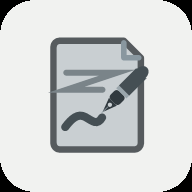

# 安安简记

**不联网的笔记应用：私密真加密 · 本地 OCR · A4 600 DPI 导出 · 每条笔记一款皮肤**

`无 INTERNET 权限` `完全离线` `无账号 · 无订阅` `Android 10+` `v1.1`

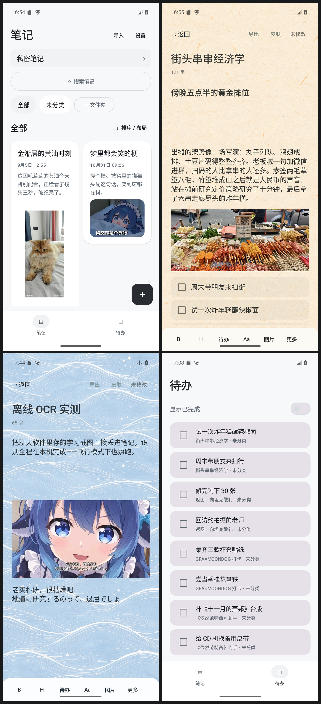

---

## 它和你在用的笔记，差在哪

| 能力 | 安安简记 | 云笔记类应用 | 系统便签类 |
|---|---|---|---|
| 联网权限 | **没有。应用根本无法联网** | 必需（云端同步） | 部分需要 |
| 运行时权限 | **零项，无需任何授权弹窗** | 存储 / 通知等 | 少量 |
| 私密内容保护 | 独立加密区（Argon2id 口令派生 + AES-GCM） | 多为应用锁，或托管在云端 | 基本没有 |
| 图片文字识别（OCR） | **本地离线**，飞行模式照跑 | 多数要上传到服务器 | 基本没有 |
| 每条笔记皮肤 | ✅ **11 款，逐条独立** | ❌ 只有全局主题 | ❌ |
| 待办 | 笔记内待办块 + 全局聚合页 | 常需另装应用 | 弱 |
| 导出 | A4 600 DPI PNG / PDF / 社交长图 / TXT / Markdown ZIP | 受限或会员功能 | 弱 |
| 备份 | 自选目录，**备份包加密**，恢复前可验证预览 | 云端（依赖服务商） | 弱/无 |
| 账号与订阅 | 无 | 需账号，核心功能常需订阅 | 无 |

---

## 一、物理级离线：连联网权限都没有

不是"支持离线使用"，而是**应用根本不具备联网能力**——权限清单里没有 `INTERNET`，且由构建流程门禁强制校验：打包时发现 INTERNET 权限会直接阻止构建。这不是口头承诺，是写进构建脚本的检查。

<table>
<tr>
<td></td>
<td>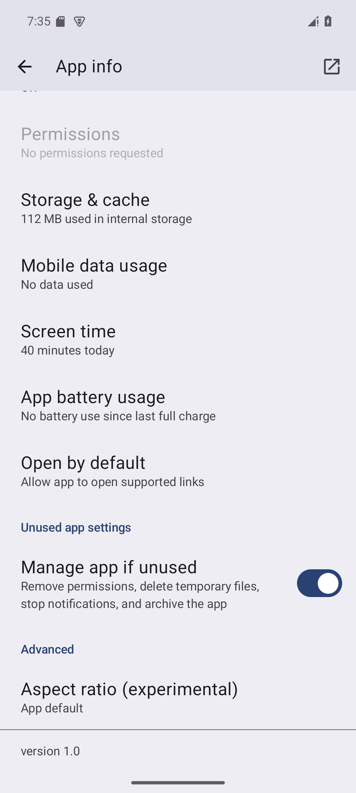</td>
</tr>
</table>

- 系统权限页显示**"无已请求的权限"**——没有任何运行时权限，安装后不会有授权弹窗
- 应用信息显示**"未使用任何数据"**——从安装那天起就是 0 字节流量
- 无账号、无同步、无推送、无统计上报；OCR 模型随安装包内置
- 后台能力只用了 4 项系统权限（息屏续跑导出/识别、开机恢复任务排期、查询网络状态以优化排期），详见文末隐私声明

## 二、私密模块：真加密，不是应用锁

普通笔记靠 Android 应用沙箱隔离；**私密模块是另一层独立的加密存储**：口令经 Argon2id 派生密钥，内容与图片附件全部 AES-GCM 加密落盘。没有口令读不到任何一条。

<table>
<tr>
<td>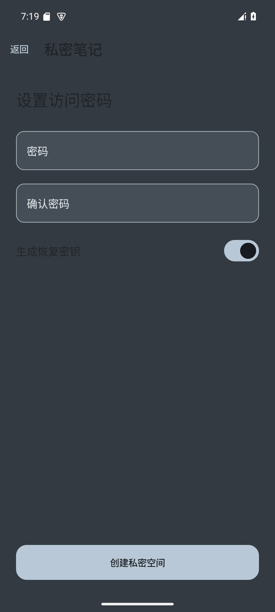</td>
<td>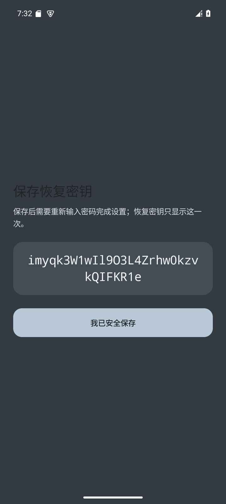</td>
<td>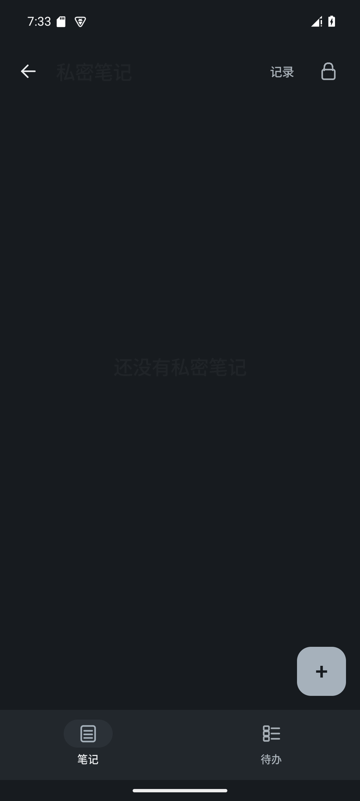</td>
</tr>
</table>

- 创建时强制走完整安全流程：设置口令 → 生成恢复密钥 → 重新输入口令确认
- **忘记口令且没有恢复密钥时，私密数据无法恢复**——这是加密设计的必然，应用会把这句话明说
- 私密内容一旦导出、分享或复制到剪贴板，就离开了加密保护边界，应用会如实提醒

## 三、本地 OCR：飞行模式下也照跑

截图、照片放进笔记即可识别文字。OCR 引擎与语言模型随安装包内置，识别全程在本机完成——开着飞行模式也照跑。

<table>
<tr>
<td>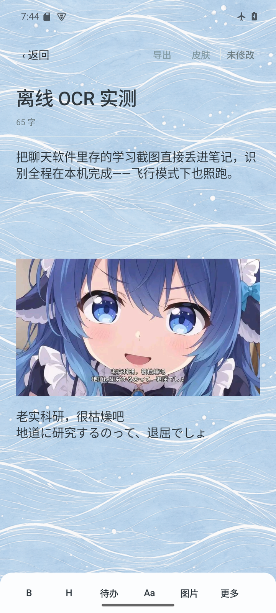</td>
<td></td>
</tr>
</table>

- 状态栏的 ✈ 就是全部网络条件：识别、编辑、保存都在离线状态完成
- 识别结果以独立文本块插入笔记，可直接再编辑
- 如实说明：识别准确性受图片质量、排版和语言影响，演示样本为清晰截图，不代表所有真实照片的效果

## 四、每条笔记一款皮肤（11 款）

不是全局换肤——**每条笔记独立拥有自己的皮肤**，已有笔记永远保留自己的样子，新建笔记可设默认皮肤。11 款皮肤带各自的水彩底纹与飘落装饰。

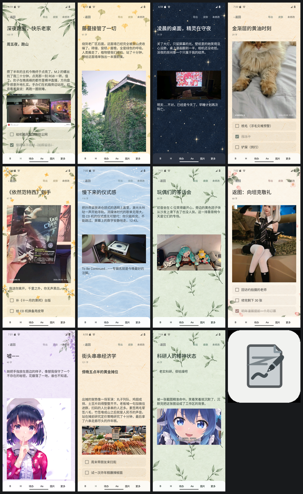

<table>
<tr>
<td>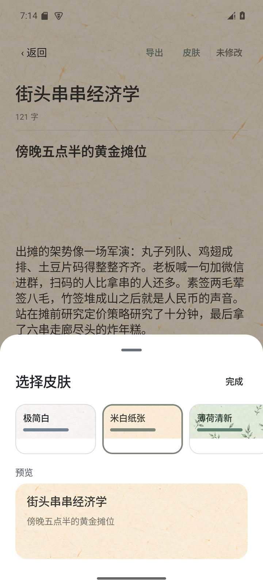</td>
<td>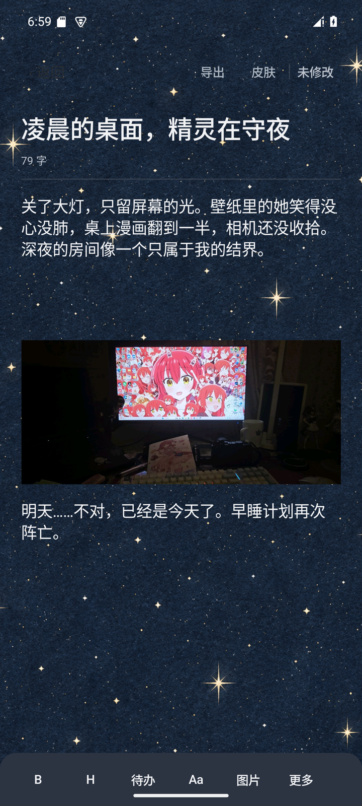</td>
</tr>
</table>

- 选择器内即时预览当前笔记效果，选中即换
- 深夜随笔配「月下星河」，读书摘抄配「米白纸张」，购物清单配「薄荷清新」——皮肤即心情

## 五、待办：写在笔记里，聚在一处

待办是笔记内的一种内容块，和文字、图片混排；所有笔记里的待办又会被**全局待办页聚合**，跨笔记追踪。

<table>
<tr>
<td>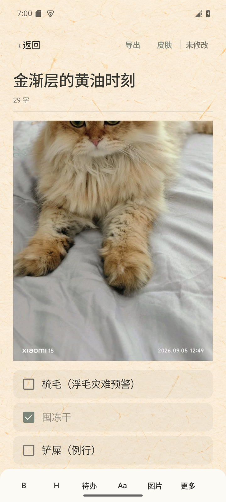</td>
<td>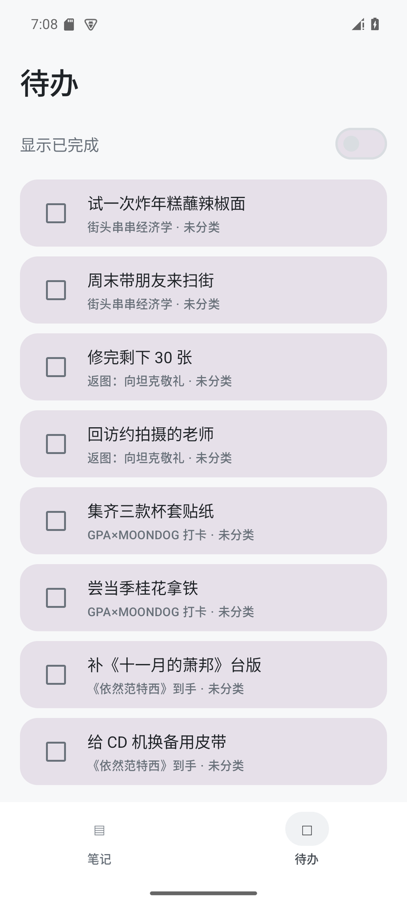</td>
</tr>
</table>

- 编辑器工具栏一键插入待办，勾选即划线
- 聚合页按来源笔记分组，可开关"显示已完成"

## 六、排版自由：所见即所得

字号、行间距随手调，设置页实时预览；编辑工具栏**始终贴在键盘上沿**，B / H / 待办 / Aa / 图片 / 更多随手可得。

<table>
<tr>
<td>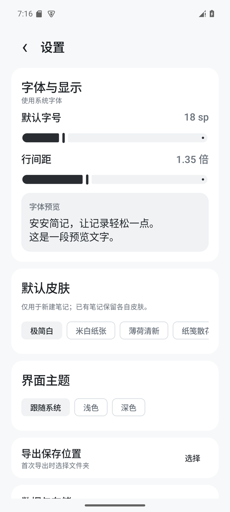</td>
<td>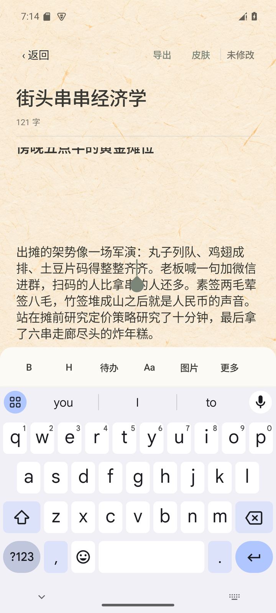</td>
<td>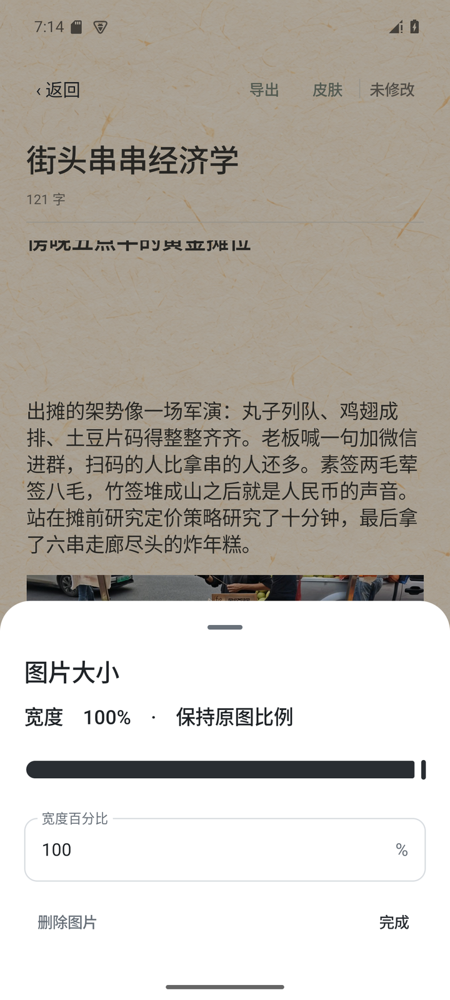</td>
</tr>
</table>

- 标题 / 正文两级呈现，加粗等行内样式
- 图片宽度按百分比精确控制（滑杆 + 数字输入），保持原图比例
- 支持引用块、分割线、横屏编辑

## 七、导出：从 A4 打印级到朋友圈尺寸

一条笔记，七种出口：**PDF（A4）**、**PNG（A4 分页，600 DPI）**、PNG 长图、朋友圈方图 1080×1080、朋友圈竖图 1080×1350、TXT、Markdown ZIP（包含原图）。可选"来自安安简记"署名。

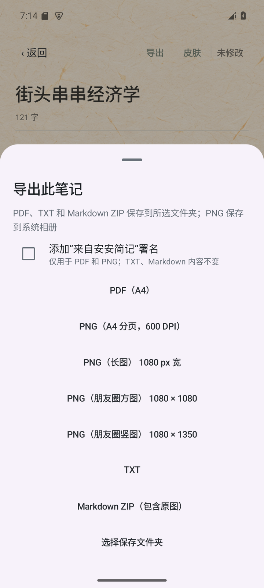

- A4 600 DPI 由自研流式编码器逐行写盘完成，超大导出不占爆内存；超过 128 MiB 安全上限会明确提示改用分页
- 导出目录由你通过系统文件选择器自选（SAF），导出记录可回溯、可再次打开或分享

## 八、分享即收藏

在任何应用里点"分享"，选安安简记，内容直接落成一条新笔记——接收过程同样不经过网络。

<table>
<tr>
<td>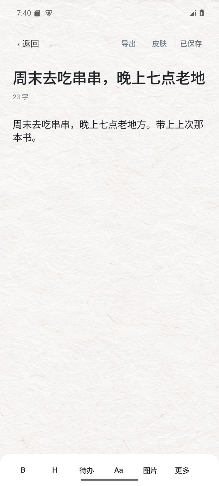</td>
<td>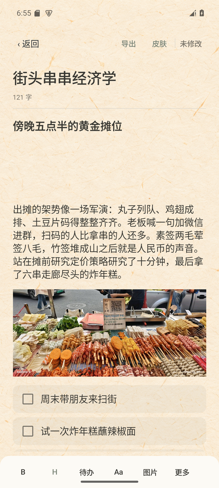</td>
</tr>
</table>

- 支持文本与图片（单张/多张）的分享导入
- 分享内容自动落库保存，进应用即可继续编辑

## 九、加密备份与恢复：迁移不依赖任何云

整机备份到你自选的目录；**备份包以独立口令加密**；恢复前先"验证并预览"，确认无误再写入。

<table>
<tr>
<td>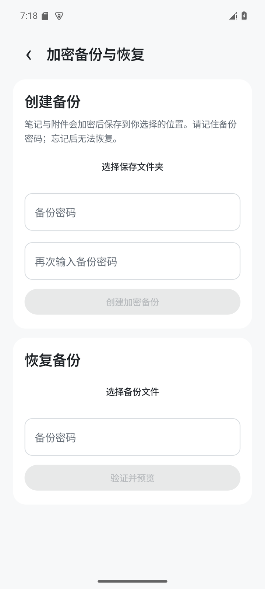</td>
<td>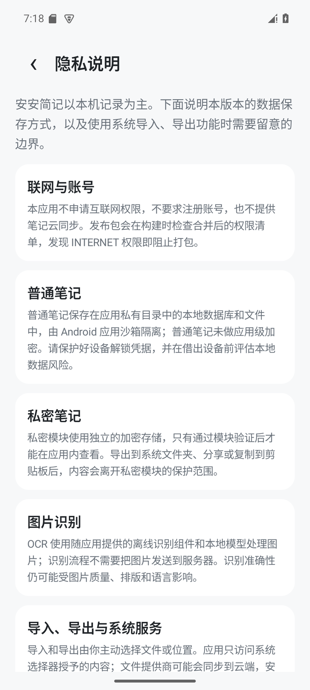</td>
</tr>
</table>

- 备份、恢复、私密内容迁移一站式完成，换机不经过任何服务器
- 建议备份包与口令分开存放

## 十、把各种屏幕都当回事

7 种异形屏切口 × 3 种显示宽度 × 3 档系统字号 × 双导航模式 × 深浅主题 = **252 种组合全部自动化测试通过**；Android 10 / 15 / 16 三个版本全量仪器测试零失败（详见文末质量与验证）。

<table>
<tr>
<td>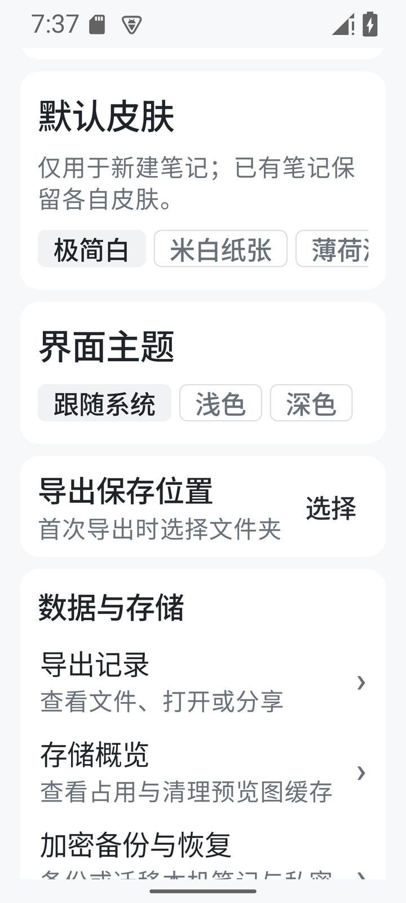</td>
<td>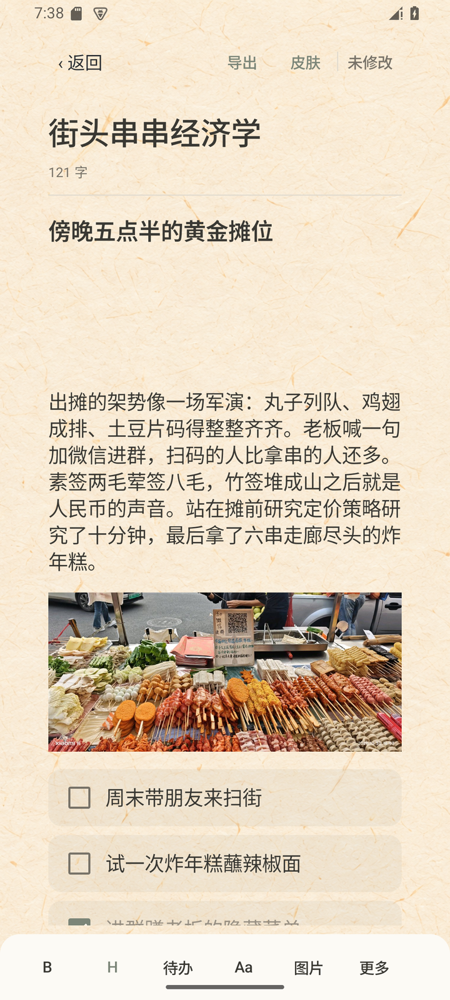</td>
<td>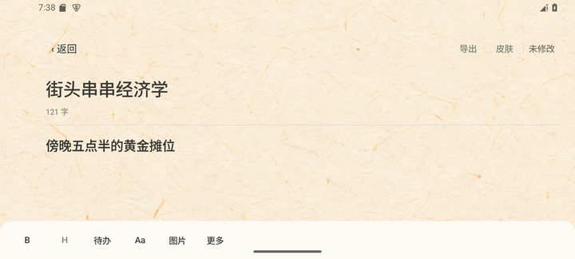</td>
</tr>
</table>

- 200% 系统字号下选项自动换行，功能完整可达
- 瀑布屏、挖孔屏、刘海屏下的安全区适配经过全组合验证
- 深色模式全局适配

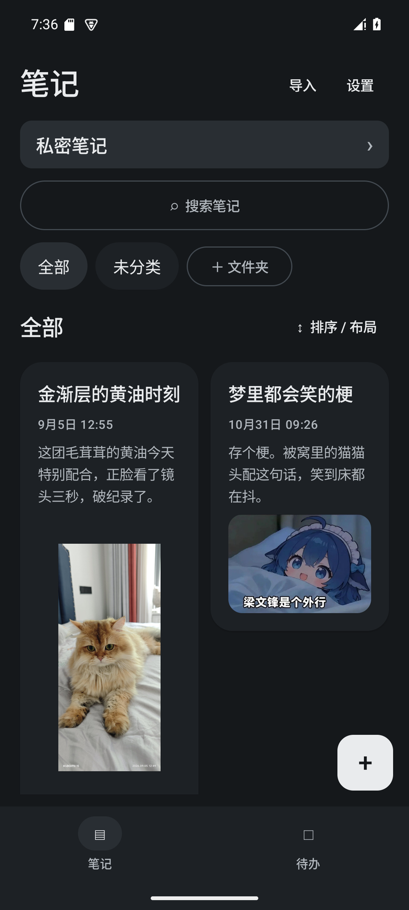

---

## 下载与安装

| 项 | 值 |
|---|---|
| 版本 | 1.1（versionCode 2） |
| 系统要求 | Android 10（API 29）及以上 |
| 安装包 | `AnAnNotes-1.1-release-signed.apk`（86,446,492 B） |
| APK SHA-256 | `f775a739395677e24c1234e1a8cb92ab54198e268515d5a7ea743eb2c31854ad` |
| 签名证书 SHA-256 | `013881549da5afddd9b6a4c18f4003ff9f2a56b9626f7f334ac4530e21a25e3a` |

- 下载后建议核对 SHA-256 再安装
- **安装不需要授予任何权限**（应用未申请运行时权限）
- 曾安装过测试版（debug 签名）的设备需先卸载测试版：正式版与测试版签名不同，系统不允许覆盖，这是 Android 签名机制的正确行为
- 应用不申请 INTERNET 权限，系统权限页会显示"无已请求的权限"——装完可以自己验证

## 隐私声明

以上能力全部有对应的系统级验证方式。核心边界如下，应用内"设置 → 隐私说明"也有一份同样的说明（见上文截图）：

- **普通笔记**保存在应用私有目录中的本地数据库和文件中，由 Android 应用沙箱隔离；**普通笔记未做应用级加密**。请保护好设备解锁凭据，并在借出设备前评估本地数据风险。
- **私密模块**使用独立加密存储（Argon2id + AES-GCM），只有通过口令验证后才能在应用内查看。导出到系统文件夹、分享或复制到剪贴板后，内容会离开私密模块的保护范围。
- **OCR** 使用随应用提供的离线识别组件和本地模型处理图片；识别流程不需要把图片发送到服务器。
- 本应用不申请互联网权限，不要求注册账号，也不提供笔记云同步。发布包会在构建时检查合并后的权限清单，发现 INTERNET 权限即阻止打包。
- 加密实现未经第三方独立审计。

## 已知限制

- 皮肤底图分辨率约 1024×1536，在 A4 600 DPI 打印下存在清晰度天花板（纸纹类皮肤无碍，插画类两款较明显）
- OCR 对真实照片、手写体、复杂背景的准确率未做量化承诺
- 加密实现未经第三方独立审计
- 无云同步是设计选择，不是待办

## FAQ

**忘记私密口令怎么办？**
无法找回。口令不存任何副本；这就是为什么创建时会引导生成恢复密钥。

**换手机怎么迁移数据？**
设置 → 加密备份与恢复：旧机创建加密备份包 → 拷贝到新机 → 验证并预览 → 恢复。全程不经过网络。

**为什么没有账号/云同步？**
应用没有联网权限——这是隐私模型的地基，不是功能缺失。

**会收费吗？**
无账号、无订阅、无内购。

## 质量与验证

- Android 10 / 15 / 16 三个系统版本全量仪器测试（每版本 232–234 项）全部通过
- 7 种切口 × 3 宽度 × 3 字号 × 双导航 × 深浅主题的 252 组合显示矩阵，在 Android 15 与 16 上全组合通过（Android 10 镜像支持的 5 种切口 180 组合全过）
- JVM 单元测试全绿；构建契约（包名 / minSdk / 无 INTERNET / 应用名）每次构建强制校验
- 完整验证记录见 [`docs/superpowers/verification/`](docs/superpowers/verification/)

## 关于

作者：WonderAnn · 当前版本 1.1
