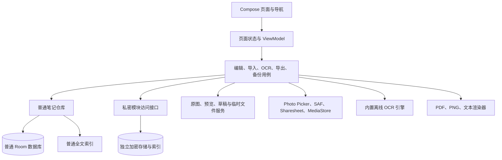

# 安安简记（AnAn Notes）V1 总体技术设计

- 状态：技术设计草案，供逐步实现与审阅；代码示例为目标接口，不表示已经实现
- 日期：2026-09-27；导出与存储章节更新：2026-09-29；内置皮肤管线更新：2026-10-05
- 产品规则：[V1 产品与界面设计](2026-09-26-anan-notes-v1-design.md)
- 富文本专题：[富文本编辑设计](2026-09-27-anan-notes-rich-text-design.md)
- 执行顺序：[V1 实现计划](../plans/2026-09-27-anan-notes-v1-implementation.md)
- 密码学专题：`docs/superpowers/security/2026-09-27-anan-notes-private-crypto.md`，在实现计划任务 8 的安全评审中形成

本文件规定模块职责、数据契约和跨模块流程。产品规格决定用户可见行为；实现计划记录进度和任务。本文件的接口示例需要按阶段落到 Kotlin 代码，并随 Room 迁移、设备验证结果同步更新。所有“目标”字段和接口均未因此自动成为已交付功能。

## 1. 约束与当前基线

- Android 手机竖屏优先，最低 Android 10／API 29。原生 Kotlin、Jetpack Compose、Material 3、Room、Coroutines/Flow，单 Activity 与 Navigation 3。
- 不声明 `INTERNET`，不要求账号；选择图片、打开或保存文件、接收 QQ／微信分享都走用户主动触发的系统接口。应用私有数据不由 Android 自动云备份。
- 普通笔记与私密笔记分别存储、索引、缓存、列出待办和记录导出。普通模块不能依赖私密模块来完成常规操作。
- 回收站保留 30 天；移入回收站仍保留原图、皮肤、内容块、OCR 与待办，永久删除才清理不再被引用的原图。
- 首版有六种内置皮肤（含“纸笺散花”）；字号和行距采用全局默认值加单条笔记覆盖。图片显示宽度为 10%–100%，保持比例，默认居中。
- A4 PDF、600 DPI 分页 PNG、长图、1080 × 1080／1080 × 1350 社交图片、TXT 和 Markdown ZIP 均须离线输出；发布安装包不超过 300 MB。

当前代码已包含普通 Room 数据库、文件夹和笔记仓库、首页卡片、自动保存与草稿恢复、皮肤和字体设置、图片原图与预览缓存、全文搜索、待办页、富文本编辑及独立私密存储。导入已有系统分享文字/图片、首页 SAF 单文件选择和 TXT/Markdown UTF-8 内容读取，建立新笔记并复用图片块存储。普通导出已接通首页多选及编辑页单条快速导出，支持 A4 PDF、TXT、Markdown ZIP、四种 PNG、SAF 位置记忆、MediaStore 图片发布，以及普通导出记录和普通存储概览；最新实现与验证边界见第 8 节、[导出存储方针](../plans/2026-09-28-anan-notes-export-storage-guideline.md)及[编辑页单条导出验证报告](../verification/2026-10-01-editor-quick-export-verification.md)。私密密码再验证导出、私密加密历史、普通/私密离线 OCR 代码路径和相关自动化测试已接入；当前仅在 MuMu API 32 上完成部分验证，系统 SAF/相册、QQ/微信、更多 API 和异形屏矩阵尚待验收。加密备份/合并恢复、回收站页面、完整设置/首次说明仍待后续实施，不把代码存在或单设备通过等同于 V1 全面验收。OCR 模型选择与限制见[离线 OCR 决策](2026-10-01-anan-notes-offline-ocr-decision.md)。

兼容既有调用的 `NoteRepository.saveDraft(NoteDraft, existingNoteId): String?` 仍可保存普通笔记；编辑器已改用 `saveVersioned` 返回显式 `Saved`、`EmptyNotSaved` 或 `Conflict`。当前 `NoteBlockDraft` 默认携带 UUID，仓库优先使用块 ID；仅空 ID 的兼容调用回退到旧位置/类型映射。仓库的图片宽度写入范围仍为 1%–100%，与批准的 UI/高清导出 10%–100% 规则不完全一致，后续需独立测试并统一，不在本轮导出任务中悄悄改写既有数据。首页排序已通过 `HomeViewPreferenceEntity` 和 Room 迁移按“全部”或文件夹 ID 独立保存，相关实现以当前代码和迁移测试为准。

### 富文本专题实现基线（2026-09-27）

富文本专题已按[专项实现计划](../plans/2026-09-27-anan-notes-rich-text-implementation.md)完成任务 1–6：共享 UTF-16 半开区间模型与 ANFM v1 codec；Room v5→v6 nullable `formattingBlob` 迁移；普通 ANAN 草稿 v3（读取 v1/v2）；私密 ANVS 快照 v2（读取 v1，外层 ANPR 不变）；普通与私密编辑器的 B/I/S、单级标题、引用转换、未知格式保护、格式化草稿恢复。搜索仍只使用纯文本，导出渲染管线没有在本专题中实现。

输入法组合输入在 composition 活跃期间不写入草稿或触发正式保存；提交或取消 composition 后再持久化最终文本与格式。普通与私密工具栏的启用、混合选区状态均由文本和格式范围计算，强调色来自当前皮肤。专题未新增运行时依赖或应用权限；应用源 Manifest 不声明 `uses-permission`。

阶段验证记录（2026-09-28，导入进程恢复幂等性）：完整 JVM 测试 105 项通过；MuMu Android 12／API 32 instrumentation 70 项通过；`lintDebug` 0 errors、7 warnings；`assembleDebug` 成功，Debug APK 为 39,498,997 字节（约 37.7 MiB）。这是当时版本的历史证据，不是最新状态，不替代小米真机的字体缩放、输入法和 QQ／微信分享验收。当前工作区没有 Git 元数据，没有生成 commit。

阶段验证记录（2026-09-28，普通导出稳定性加固）：当时完整 JVM 138/138、MuMu Android 12/API 32 instrumentation 81/81；Lint 0 Error、7 Warning、2 Hint；Debug APK 40,069,521 字节，构建契约通过。该记录对应仅 TXT/Markdown 的旧增量，不再作为最新功能清单。当前导出实现与本轮验证入口统一指向 [高清导出及存储方针第 8 节](../plans/2026-09-28-anan-notes-export-storage-guideline.md#8-本轮证据)，避免把旧测试数字或旧“未实现”表述混作当前状态。

## 2. 模块关系与依赖方向



| 模块 | 拥有的数据与职责 | 可以依赖 | 不应承担 |
| --- | --- | --- | --- |
| Compose／导航 | 输入、反馈、可见状态、普通与私密页面切换 | ViewModel | 文件写入、密钥、数据库事务 |
| 编辑用例 | 内容块操作、草稿快照、自动保存和恢复 | 普通仓库、草稿服务；私密编辑使用独立接口 | 直接使用外部 URI 作为长期图片路径 |
| 普通仓库 | 普通笔记、文件夹、待办、回收站和索引的一致性 | Room、普通文件服务 | 私密正文或私密索引 |
| 图片服务 | 原图导入、预览生成、引用检查和清理 | 应用私有文件、系统内容读取器 | 删除仍在回收站或其他块引用的原图 |
| OCR／导入／导出用例 | 作业状态、输入验证、格式转换、输出提交 | 相应范围的数据仓库和文件服务 | 绕过私密解锁、写入普通索引中的私密内容 |
| 私密模块 | 解锁会话、私密记录和附件、私密待办／搜索／导出记录 | 独立加密存储 | 把明文放进普通 Room、普通缓存或系统最近任务预览 |

V1 保持单个 Gradle `app` 模块，按 `core`、`data`、`feature`、`security` 包划清职责；现在拆成多个 Gradle 模块没有可测的收益。用例面向小型接口，现有 `NoteRepository` 可以逐步实现普通笔记接口。私密存储使用独立接口，不以传入 `isPrivate` 布尔值的方式复用普通仓库。

文件归属按 `env-check/app/src/main/java/com/anan/anannotes/` 起算；非现有接口仍为目标设计。普通写入由 `NoteRepository.kt` 实现；块 ID/格式在 `core/model/BlockModels.kt`，schema 在 `data/local/AnAnDatabase.kt`，首页偏好在 `data/repository/HomeViewPreferenceRepository.kt`。导出当前由 `feature/export/ExportService.kt` 定义快照、事件和文件存储契约；`SafExportFileStore.kt`/`AndroidSafDocumentAccess.kt` 管理 SAF，`MediaStorePngExportFileStore.kt` 管理图库待发布条目；PDF、社交 PNG、A4/长图 renderer 和 `StreamingPngWriter` 在 `feature/export`；普通记录/统计在 `data/repository`，相应 VM/页面在 `feature/settings`。`OrdinaryNoteStore`、统一图片接口、导入/OCR/备份的部分协调接口仍需按对应阶段引入，不因文档列名而视作存在。每个新接口与首个调用者在同阶段落地，避免空壳。

## 3. 笔记、内容块与数据库

### 3.1 普通数据关系

原 Room v1 表为 `folders`、`notes`、`note_blocks`、`todos`、`export_history`；当前 v2 通过 `HomeViewPreferenceEntity` 增加 `home_view_preferences` 表。一条笔记属于一个一级文件夹；系统“未分类”有固定 ID `system-uncategorized`。“全部”只是筛选视图，不是可写入的文件夹。`notes.deletedAtMillis` 非空表示在回收站，此时仍保留块、待办和原图引用。

笔记的 `id`、内容块的 `id` 均使用稳定唯一值。块的 `position` 只控制显示顺序，移动或编辑时不更换块 ID；待办通过 `blockId` 绑定对应的 TODO 块。现有 `NoteBlockDraft` 尚无 ID，目标是在编辑状态创建块时即赋 ID，`saveDraft` 按 ID 更新并验证块归属，不再用列表位置猜测 ID。迁移和旧数据读取时保留原 `BlockEntity.id`。

目标字段与约束如下；现有字段继续使用，新增字段需通过显式 Room migration 落地，不能使用破坏性重建：

| 对象 | 核心字段 | 不变量 |
| --- | --- | --- |
| `NoteEntity` | `id`、`folderId`、`title`、`titleManuallySet`、创建/修改时间、`skinId`、字号/行距覆盖、置顶、删除时间；目标新增 `contentRevision` 和可空的唯一 `importRequestId` | `contentRevision` 每次内容或外观事务提交递增；非空 `importRequestId` 将一次系统导入请求绑定到唯一笔记；置顶优先于两种时间排序 |
| `BlockEntity` | `id`、`noteId`、`position`、`type`、`text`、图片引用、宽度、对齐、OCR 状态；目标新增版本化 `formattingBlob` 和可选裁剪矩形 | `position` 在同一笔记内唯一且可重排；图片宽度限 10%–100%；图片高度由原始宽高比计算；富文本编码见[专题设计](2026-09-27-anan-notes-rich-text-design.md) |
| `TodoEntity` | `id`、`noteId`、`blockId`、文字、完成状态、修改时间 | 一个 TODO 块至多有一条对应待办；重排不改变完成状态 |
| `ImageAssetEntity`（目标） | `assetId`、应用私有相对路径、MIME、宽高、字节数、校验摘要 | 内容块只引用 `assetId`；原图文件不可被预览缓存覆盖 |
| `ExportHistoryEntity` | 格式、时间、文件名、位置 URI、成功/失败和错误码 | 普通库只存普通记录，最多保留 100 条，不保存正文和图片副本 |
| `AppSettingsEntity`（目标） | 默认皮肤、字号、行距、主题模式、首次隐私说明确认状态 | 修改默认值只影响尚未单独覆盖的新笔记或继承项 |
| `HomeViewPreferenceEntity` | 视图键（`all` 或文件夹 ID）、最近编辑／创建时间排序 | 每个文件夹及“全部”视图独立记住排序；置顶始终优先 |

`BlockType` 已有 TEXT、IMAGE、TODO、QUOTE、DIVIDER、OCR_TEXT。TEXT／QUOTE／OCR_TEXT 保存可编辑文本；TODO 的文本与 `TodoEntity.text` 在一次事务内同步；DIVIDER 不带正文；IMAGE 引用原图。图片裁剪若启用，仅保存归一化显示裁剪矩形，原图字节不被覆盖。首行自动标题取正文首个文本块的首行，保留该行正文；手动标题使用独立字段覆盖自动规则。无有效文本、图片或待办内容时，新笔记不入正式库。

加粗、斜体、删除线等内联格式以半开区间 `[start, end)` 标在文本块上，索引采用 Kotlin 字符串的 UTF-16 偏移；持久化时由独立版本化 `formattingBlob` 编码。每次文本编辑必须调整并校验区间，`0 <= start < end <= text.length`；搜索索引与 TXT 导出使用无格式纯文本，Markdown 导出转换为相应标记。标题级别、引用和待办是块属性或块类型，不靠扫描视觉样式反推。旧版纯文本块读入时格式对象为 BODY/空区间。区间规则、格式 codec、编辑器光标行为及兼容性以[富文本专题设计](2026-09-27-anan-notes-rich-text-design.md)为准。

现有 `NoteBlockDraft` 的目标字段如下。新增的 `id` 由编辑器创建块时生成一次；从旧记录读取时沿用 `BlockEntity.id`。`assetId`、格式区间和裁剪参数通过显式数据库迁移接入，旧版 `assetPath` 由迁移适配器读取，清理前先验证所有引用已转换。

```kotlin
data class NormalizedRect(val left: Float, val top: Float, val right: Float, val bottom: Float)

data class NoteBlockDraft(
  val id: String,
  val type: BlockType,
  val text: String? = null,
  val assetId: String? = null,
  val widthPercent: Float = 100f,
  val alignment: BlockAlignment = BlockAlignment.CENTER,
  val aspectRatio: Float? = null,
  val ocrStatus: OcrStatus? = null,
  val formatting: BlockFormattingState = BlockFormattingState.Supported(BlockFormatting()),
  val crop: NormalizedRect? = null,
)
```

`NormalizedRect` 满足 `0 <= left < right <= 1`、`0 <= top < bottom <= 1`；`aspectRatio` 为正的原图显示宽高比。若块中的格式区间或裁剪参数无效，编辑用例应拒绝保存该变更并保留上一份有效文档，不让坏数据进入导出流程。

### 3.2 面向用例的目标接口

以下示例省略常规 `import`，复用现有 `NoteDraft`、`NoteDocument`、`NotePreviewModel` 和 `NoteSortOrder`。它定义将来要保证的行为；当前 `NoteRepository` 尚未实现全部签名。

```kotlin
data class EditSnapshot(
  val draftId: String,                 // 新笔记在得到 noteId 前也有稳定草稿 ID
  val noteId: String?,
  val baseContentRevision: Long,       // 新笔记为 0；编辑已有笔记时为打开时的正式版本
  val localRevision: Long,             // 每次编辑单调递增
  val draft: NoteDraft,
)

sealed interface SaveResult {
  data class Saved(val noteId: String, val contentRevision: Long) : SaveResult
  data object EmptyNotSaved : SaveResult
  data class Conflict(val currentRevision: Long) : SaveResult
}

interface OrdinaryNoteStore {
  fun observeDocument(noteId: String): Flow<NoteDocument?>
  fun observePreviews(folderId: String?, order: NoteSortOrder): Flow<List<NotePreviewModel>>
  suspend fun save(snapshot: EditSnapshot): SaveResult
  suspend fun moveToTrash(noteId: String)
  suspend fun restore(noteId: String)
  suspend fun purgeExpiredTrash(nowMillis: Long): List<String>
}
```

`save` 的正式笔记、块、待办、普通搜索索引与 `contentRevision` 在同一数据库事务内变化；笔记皮肤、标题等外观或元数据编辑也递增该版本。`Conflict` 不覆盖另一个已提交版本。普通仓库遇到 I/O 或数据库失败应抛出可归类的异常，由编辑用例保持草稿并展示失败状态；不得把失败折叠为 `EmptyNotSaved`。现有返回 `String?` 的 `saveDraft` 可先由适配层包装，随后迁移到上述结果类型。

## 4. 普通与私密数据隔离

私密笔记、附件、OCR 文本、搜索索引、草稿、待办和导出记录只属于私密存储边界。普通 Room 库的表、普通 FTS、首页预览、普通待办、普通导出记录、日志和导航恢复状态均不能保存私密标题、正文、缩略图或数量。普通首页可展示固定的“加密笔记”入口文案，但不从私密库取计数或摘要。

私密模块解锁后获得不含可直接读取密钥的短期访问能力；锁定、进入后台或进程死亡后该能力失效。私密页面每次读取都验证访问能力；不能只在打开页面时检查一次。普通导航只保存私密入口路由；私密笔记 ID 和内容不持久化到普通导航回退栈。私密页面活动时保护系统最近任务预览，退出模块清空私密 UI 状态与可观察缓存。

```kotlin
interface PrivateAccess                         // 不暴露数据密钥，可撤销
@JvmInline value class PrivateNoteId(val value: String)

data class PrivateNotePreview(
  val id: PrivateNoteId,
  val title: String,
  val updatedAtMillis: Long,
)

data class PrivateNoteDocument(
  val id: PrivateNoteId,
  val title: String,
  val titleManuallySet: Boolean,
  val blocks: List<NoteBlockDraft>,
  val todos: List<PrivateTodo>,
  val skinId: String,
  val fontSizeSpOverride: Float?,
  val lineSpacingMultiplierOverride: Float?,
  val contentRevision: Long,
)

data class PrivateTodo(
  val id: String,
  val blockId: String,
  val text: String,
  val completed: Boolean,
)

data class PrivateEditSnapshot(
  val draftId: String,
  val noteId: PrivateNoteId?,
  val title: String,
  val titleManuallySet: Boolean,
  val blocks: List<NoteBlockDraft>,
  val skinId: String,
  val fontSizeSpOverride: Float?,
  val lineSpacingMultiplierOverride: Float?,
  val baseContentRevision: Long?,
  val localRevision: Long,
)

sealed interface PrivateSaveResult {
  data class Saved(val noteId: PrivateNoteId, val contentRevision: Long) : PrivateSaveResult
  data object EmptyNotSaved : PrivateSaveResult
  data class Conflict(val currentRevision: Long) : PrivateSaveResult
}

interface PrivateModule {
  suspend fun unlockWithPassword(password: CharArray): PrivateAccess
  suspend fun unlockWithRecoveryKey(key: CharArray): PrivateAccess
  fun lock()
}

interface PrivateNoteStore {
  fun observePreviews(access: PrivateAccess): Flow<List<PrivateNotePreview>>
  suspend fun read(access: PrivateAccess, noteId: PrivateNoteId): PrivateNoteDocument?
  suspend fun save(access: PrivateAccess, snapshot: PrivateEditSnapshot): PrivateSaveResult
  suspend fun search(access: PrivateAccess, query: String): List<PrivateNoteId>
  suspend fun moveToTrash(access: PrivateAccess, noteId: PrivateNoteId)
  suspend fun restore(access: PrivateAccess, noteId: PrivateNoteId)
  suspend fun purgeExpiredTrash(access: PrivateAccess, nowMillis: Long): List<PrivateNoteId>
}

interface PrivateEditorDraftStore {
  suspend fun writeAtomic(access: PrivateAccess, snapshot: PrivateEditSnapshot)
  suspend fun listRecoverable(access: PrivateAccess): List<PrivateEditSnapshot>
  suspend fun clearIfAtMost(access: PrivateAccess, draftId: String, revision: Long)
}
```

私密草稿、回收站也只能通过有效 `PrivateAccess` 读取；模块重新解锁后，按第 6 节相同的修订号规则提示恢复或丢弃，并在私密存储范围内清理已超过 30 天的回收站记录。锁定期间不为定时清理而解锁私密数据。私密导出还需重新输入当前模块密码，认证成功后获得一次性导出授权；输出文件按已批准规则是普通可读文件，界面必须先提示它不再受私密模块保护。恢复密钥用于恢复或重置，不作为日常导出凭证。私密 OCR 若在锁定时仍排队，应暂停并在重新解锁后继续；不能把解密后的图片写到普通 WorkManager 输入、普通缓存或临时文件。私密数据格式、密钥封装、算法参数、恢复和认证节流由独立安全设计审查，本文件不冻结这些细节。

## 5. 图片、预览缓存与文件生命周期

普通原图放在应用私有 `filesDir/notes/assets/`，预览放在可重建的 `cacheDir/notes/previews/`，普通草稿放在 `filesDir/drafts/`，导出临时结果放在 `cacheDir/exports/<jobId>/`。私密附件、草稿与预览使用 `filesDir/private/` 下的独立加密存储策略，不共享普通缓存路径。数据库只保存内部相对路径或 `assetId`，不能把 Photo Picker／QQ／微信临时 URI 当成长期文件引用。

图片选择后立即从授权 URI 复制原始字节到同目录临时文件，校验可读性、MIME、大小与尺寸后以原子重命名提交；再建立资产记录并在笔记事务中引用。文件系统与 Room 不能组成单一事务，故导入作业记录临时文件 ID：数据库提交失败则清理临时文件；进程中断时启动清扫器删除未被引用的暂存文件；绝不因为暂存清理删除已被正式块引用的资产。预览按需采样解码，尊重原图方向，使用单独文件名写入；正式导出读取原图。

```kotlin
data class StoredImage(
  val assetId: String,
  val mimeType: String,
  val widthPx: Int,
  val heightPx: Int,
  val byteCount: Long,
)

interface OrdinaryImageStore {
  suspend fun importFrom(uri: Uri): StoredImage
  suspend fun openOriginal(assetId: String): InputStream
  suspend fun ensurePreview(assetId: String, maxEdgePx: Int): File
  suspend fun deleteUnreferenced(assetIds: Set<String>): Int
  suspend fun clearPreviewCache(): Long
}
```

| 事件 | 原图 | 预览缓存 | 记录与 UI |
| --- | --- | --- | --- |
| 插入成功 | 保留 | 后台或首次显示时生成 | 块引用稳定 `assetId` |
| OCR 失败或取消（选择保留图片） | 保留 | 可以重建 | 不写入不完整 OCR 文本 |
| 清理缓存 | 保留 | 删除，按需再生 | 笔记和 OCR 不变 |
| 移入 30 天回收站 | 保留 | 可清理 | 恢复后图片仍可用 |
| 永久删除或到期清理 | 仅在无任何块引用后删除 | 对应缓存删除 | 文件清理失败可重试，不撤销已完成的数据库删除 |

图片显示宽度按内容区百分比计算，限制 10%–100%；编辑面板同时提供滑块和百分比数值输入，高度由原图比例推导。裁剪只修改显示参数，并保持原图供再次调整与高质量导出。导入超大图时避免原尺寸整图解码；缺失／损坏原图必须给出可理解的提示，剩余内容仍可编辑。私密原图的清理与回收站规则相同，但所有读取必须经过已解锁的私密访问接口。

## 6. 自动保存、异常草稿与恢复

编辑器维护 `localRevision`、最后已写草稿的修订号、最后正式保存的修订号，以及 `CLEAN / DIRTY / SAVING / SAVED / FAILED` 状态。每次编辑先更新内存状态和修订号，再串行写入草稿快照，并在停止输入后合并正式笔记写入；现有 400 ms 自动保存间隔可作为初始值。进入后台或主动返回时立即等待当前快照落盘。写失败时保留当前编辑内容和草稿，持续显示失败状态，允许重试；不得假装已保存后退出。

```kotlin
data class EditorDraftSnapshot(
  val draftId: String,
  val noteId: String?,
  val importRequestId: String?,
  val folderId: String,
  val baseContentRevision: Long,
  val localRevision: Long,
  val savedAtMillis: Long,
  val draft: NoteDraft,
)

interface EditorDraftStore {
  suspend fun writeAtomic(snapshot: EditorDraftSnapshot)
  suspend fun listRecoverable(): List<EditorDraftSnapshot>
  suspend fun clearIfAtMost(draftId: String, committedRevision: Long): Boolean
}
```

当前实现的 `EditorDraftSnapshot` 还保存 `folderId`、`savedAtMillis`、可空 `importRequestId` 和完整 `NoteDraft`。普通草稿写入应用私有 `filesDir/drafts/`，由 `FileEditorDraftStore` 以 `ANAN` 魔数和格式版本 4 的长度前缀二进制格式保存；版本 1–3 读取时将 `importRequestId` 设为 null。文件名只使用 UUID，不包含标题或正文。写入先在同目录临时文件落盘并同步文件句柄，再原子替换目标文件；文件上限为 64 MiB。已知旧版本可按兼容规则解码；未知版本或损坏快照会报错并保留原文件，不会静默删除。该接口只服务普通笔记；私密草稿必须经独立加密接口写入，不能落在普通草稿目录。

当前 Room 数据库版本为 7。显式 1→2 至 6→7 迁移保留既有数据；2→3 为既有普通笔记增加 `contentRevision` 并初始化为版本 1，6→7 增加可空导入请求 ID 和唯一索引。`NoteRepository.saveVersioned` 在事务中校验预期版本并递增修订号；过期编辑返回 `Conflict`，不得覆盖较新的正式笔记。兼容既有调用的 `saveDraft` 仍保留。草稿清理只移除不超过已成功提交修订号的快照，避免旧保存任务删除较新输入。

```text
编辑 → localRevision + 1 → 原子写草稿 → debounce 正式保存
                                      ├─ 成功且修订号仍最新：标记已保存，清理已提交草稿
                                      ├─ 成功但有更新输入：保留新草稿，继续保存
                                      └─ 失败：保留草稿与编辑状态，展示重试
```

下次启动发现草稿比已保存版本新时，显示“恢复／丢弃”；恢复先载入草稿继续编辑，丢弃只删除草稿，不删除正式笔记。如果正式笔记版本也已经变化，禁止静默覆盖，展示当前已保存版本与草稿的时间及保留选择。空白新笔记正常退出不建立正式记录并清理空草稿。强制停止、进程死亡、旋转与后台恢复都应由真实持久化快照验收；突然断电时仅能保证最后一次成功落盘的修订号，不承诺尚未写盘的按键。

系统分享和文件导入的 `importRequestId` 是随机请求标识，不包含载荷或用户身份。新笔记首次保存时，普通笔记、内容块和 `importRequestId` 在同一 Room 事务提交；Room 对非空 ID 建唯一索引。应用恢复时按顺序查找已保存的请求笔记、完全匹配该 ID 的持久化草稿，最后才处理路由携带的原始载荷；已保存笔记直接打开，匹配草稿进入既有“恢复／丢弃”确认流程，不再次消费分享 URI。若数据库已提交但旧草稿尚未写回 `noteId`，仅当草稿与已保存笔记的完整 `NoteDraft` 相同才自动清除该过期快照；内容不同仍保留恢复/冲突选择。重复保存同一 ID 返回原笔记而不覆盖其内容。Room 6→7 迁移为既有笔记填入 null，不改变其内容。

## 7. 导入、离线 OCR 与搜索

`ACTION_SEND`／`ACTION_SEND_MULTIPLE` 只接收用户主动分享的文本、图片或文件。TXT／Markdown／图片从系统文件选择器进入；Photo Picker 供编辑页插图。导入控制器读取 `ContentResolver` 流、识别受支持 MIME、拒绝不可读或超出可处理上限的输入，复制图片后生成新笔记；默认使用首页当前文件夹，用户可在导入时改选。QQ／微信只是系统分享来源，不接入聊天 API 或登录。

```kotlin
enum class ImageImportMode { IMAGE_ONLY, IMAGE_AND_OCR, OCR_ONLY }

sealed interface ImportItem {
  data class Text(val value: String) : ImportItem
  data class Document(val uri: Uri, val mimeType: String?) : ImportItem
  data class Image(val uri: Uri) : ImportItem
}

data class ImportRequest(
  val folderId: String,
  val items: List<ImportItem>,
  val imageMode: ImageImportMode?,
)

interface ImportCoordinator {
  suspend fun import(request: ImportRequest): List<String> // 新建的普通 noteId
}
```

OCR 引擎只有离线实现；模型须先经过中文／英文／数字混排、换行、低清照片、冷启动、内存、许可证和 APK 增量评估。普通 OCR 作业持久化 `jobId`、来源块 ID、模式和状态；后台执行进度分为加载模型、预处理、识别和整理，UI 显示估算的 0%–100%，不把估算百分比解释为逐像素精度。引擎接口只拿到需要读取的图片流，不依赖 UI 页面存活：

```kotlin
sealed interface OcrEvent {
  data object LoadingModel : OcrEvent
  data class Progress(val percent: Int) : OcrEvent
  data class Succeeded(val text: String) : OcrEvent
  data class Failed(val code: String) : OcrEvent
}

interface OcrEngine {
  fun recognize(openImage: suspend () -> InputStream): Flow<OcrEvent>
}

sealed interface OcrSourceRef {
  data class NoteImage(val noteId: String, val blockId: String) : OcrSourceRef
  data class TemporaryImage(val assetId: String) : OcrSourceRef
}

interface OcrCoordinator {
  suspend fun enqueue(source: OcrSourceRef, mode: ImageImportMode): String
  suspend fun cancel(jobId: String)
}
```

“插入图片并识别”先提交图片块，再启动 OCR；成功后在其下方插入稳定 ID 的可编辑 OCR_TEXT 块，尽量保留换行，只有成功文本参与搜索。取消和失败保留图片及可重试状态，不提交半成品文字。“只识别文字”把原图留在受控暂存区直到成功或用户取消／放弃重试，成功后只提交文字并清理暂存图，不把图片插入笔记。进程重启时普通待处理作业可由持久作业记录继续；私密作业在锁定时停止，重新解锁后由私密范围恢复。

普通全文索引只包含未永久删除的普通标题、TEXT、QUOTE、TODO 和 OCR_TEXT 成功文本；入回收站后不出现在正常结果，恢复后重新可见。索引更新和对应笔记写入保持事务或可重放的修复标记。输入停止约 300 ms 后查询；结果显示文件夹和命中片段，匹配部分加粗并使用当前主题可读的强调色。私密搜索在已解锁范围内独立执行，不把明文写入普通 FTS。

首版实现使用普通数据库内的 Room FTS4 索引；为覆盖中文连续文本的局部匹配，FTS 查询结果与安全的字面子串候选合并并去重。回收站索引条目在软删除事务中移除，恢复时从普通笔记重建；永久删除同步清理索引，版本 4→5 迁移回填现有活动笔记。私密索引尚未实现，必须由后续独立的加密存储范围提供，不能复用此普通搜索仓库。

## 8. 导出、反馈与备份

导出先读取一次不可变的笔记快照、当前皮肤／显示参数和原图引用，再计算排版，最后写入用户可访问的目标。TXT 仅包含可编辑文字、引用和待办状态；它本身不能承载皮肤和图片。Markdown ZIP 将 Markdown 和原图资源放在 `images/` 相对目录；PDF、PNG 使用当前皮肤、字体、行距、图片及 OCR 文本。“纸笺散花”由 `NoteSkinBackgroundPainter` 使用本地 Canvas 矢量绘制；Compose 编辑页和皮肤预览、PDF、社交 PNG 与画带式 A4/长图共用确定性花瓣布局，不读取远程素材。画带输出只生成可见区域附近的花纹，避免长图按画带重复构建整页装饰。默认文件名为 `文件夹_标题_YYYY-MM-DD`，清理非法字符，重名时追加序号而不覆盖旧文件。

```kotlin
sealed interface OutputTarget {
  data class DocumentTree(val uriString: String) : OutputTarget
  data object MediaStorePictures : OutputTarget
}

data class ExportRequest(
  val noteIds: List<String>,
  val format: ExportFormat,
  val target: OutputTarget,
)

sealed interface ExportEvent {
  data class Progress(val completed: Int, val total: Int) : ExportEvent
  data class ItemCompleted(val noteId: String, val fileName: String, val location: String,
    val destinationName: String? = null) : ExportEvent
  data class ItemFailed(val noteId: String, val code: String, val message: String) : ExportEvent
  data class Completed(val succeeded: Int, val failed: Int,
    val completedFiles: List<ItemCompleted> = emptyList(),
    val failedItems: List<ItemFailed> = emptyList(), val historyFailures: Int = 0) : ExportEvent
  data object Busy : ExportEvent
}

interface OrdinaryExporter {
  fun export(request: ExportRequest): Flow<ExportEvent>
}
```

普通编辑页的快速导出仍复用此普通服务，不创建私密或通用跨域导出入口。`EditorExportRules` 在 UI 调用前检查加载状态、空白新稿、输入法组合、草稿恢复、保存失败和版本冲突；有意义但未保存的稿件先通过编辑器现有 `saveMutex` 与自动保存序列化，确认最新编辑修订已写入 Room 后才提交单一 `noteId`。保存失败、冲突或空白新稿只显示反馈，不启动导出。导出期间由不可取消的模态进度层暂时阻止编辑与返回；出口的 SAF、MediaStore、成功/失败记录及反馈仍由普通导出模块负责。

批量导出逐条生成独立文件并报告各条结果，不把不同笔记合并进一份文档；某条失败不应抹掉已成功的文件。PDF 按 A4 布局并优先使用矢量文字。600 DPI 分页 PNG 的 A4 页面为 4961 × 7016 像素，写入 pHYs 23622 px/m（约 600 DPI），逐页写出；采用最多 128 行的画带和逐行 RGB/zlib 编码，不创建整页约 133 MiB ARGB 位图，不悄悄降低分辨率。长图以画带分段处理但组合为**一个**文件，宽度 1080 px、高度按内容测量，上限 32768 px、文件上限 128 MiB；超限明确失败并建议 A4 分页，不截断、不静默拆成多个文件。A4 排版额外预检 512 页、10000 块和 100 万 UTF-16 文本长度上限，失败不创建新输出。原图按实际比例布局并有界采样，单张解码最多约 900 万像素。朋友圈方图／竖图分别严格输出 1080 × 1080 和 1080 × 1350 像素，600 DPI 不适用于这两个社交预设。详见 [高清导出及存储实施方针](../plans/2026-09-28-anan-notes-export-storage-guideline.md)。

私密导出使用私密 ID 和独立调用入口。重新输入密码验证后生成一次性、短时有效的 `PrivateExportGrant`，导出用例只接受有效授权；授权本身不包含密码。私密笔记不可通过 `OrdinaryExporter` 的 `noteIds` 参数访问。私密导出的普通文件仍遵循上述保存位置和明文警示规则。

```kotlin
interface PrivateExportGrant // 一次性、可撤销，不包含密码
data class PrivateExportRequest(
  val noteIds: List<PrivateNoteId>,
  val format: ExportFormat,
  val target: OutputTarget,
)

interface PrivateExportAuthorizer {
  suspend fun authorize(access: PrivateAccess, password: CharArray): PrivateExportGrant
}

sealed interface PrivateExportEvent {
  data class Progress(val completed: Int, val total: Int) : PrivateExportEvent
  data class ItemCompleted(val noteId: PrivateNoteId, val fileName: String, val location: Uri) : PrivateExportEvent
  data class ItemFailed(val noteId: PrivateNoteId, val code: String, val message: String) : PrivateExportEvent
  data class Completed(val succeeded: Int, val failed: Int) : PrivateExportEvent
}

interface PrivateExporter {
  fun export(
    access: PrivateAccess,
    grant: PrivateExportGrant,
    request: PrivateExportRequest,
  ): Flow<PrivateExportEvent> // 事件仅在私密 UI 中消费，历史写入私密存储
}
```

PDF、TXT 和 Markdown ZIP 通过 SAF 用户选定目录输出；PNG 通过 MediaStore 写到 `Pictures/AnAn Notes/Exports`，成功提交后系统相册可见。写共享文件采用临时／待完成状态；取消或失败要删除未完成输出，已成功文件不得误删。成功反馈短暂显示文件名和位置；失败给出稳定 `AN-EXP-001` 至 `AN-EXP-004` 代码、原因和可执行建议，用户取消不记录为错误。普通与私密导出历史分别最多 100 条，清空历史只删元数据；私密历史只在解锁后显示。

**实现状态（2026-10-01 增量核对）：** 普通导出包含首页多选和编辑页单条快速导出；单条导出先串行确认最新修订持久化，再通过普通服务生成当前笔记快照。标题、正文、待办均跟踪输入法组合区间；异步待办勾选写入与导出串行化；即使已存笔记被清空也不能导出空内容。编辑页复用共享格式面板、SAF/MediaStore、普通历史及导出反馈，空白内容不会新增笔记、文件或导出记录。2026-10-01 全量强制构建中 JVM 182 项、0 失败/错误/跳过；MuMu Android 12/API 32 instrumentation 158 项、0 失败/错误、1 跳过；Lint 0 Error、12 Warning、2 Hint；APK 39,877,539 bytes；构建契约与 MuMu 安装/冷启动通过。唯一跳过是当前 MuMu 不具刘海条件的显示切口用例。详细证据见[编辑页单条导出验证报告](../verification/2026-10-01-editor-quick-export-verification.md)；更早导出实现记录见[历史验证报告](../verification/2026-09-28-export-storage-verification.md)。导出结束提示通过带 ID 的待确认状态保留到 Snackbar 确认；历史保存失败单独反馈，不把已发布文件误报成导出失败。导入选择器支持 TXT、Markdown、图片和泛型 MIME，按文件类型校验。私密验证导出与独立加密历史、真实第三方 SAF/文件管理器及 Xiaomi 真机验收、内置 OCR 与 QQ/微信分享真机验收仍未完成。屏幕适配按[全面屏与异形屏方针](../plans/2026-09-28-anan-notes-edge-to-edge-guideline.md)的 E1 开始分批进行，不把本轮成功等同于 E1–E6 已完成。

普通历史由 `data.repository.ExportHistoryRepository` 实现 `ExportHistoryRecorder`，插入与裁剪同 Room 事务，仅保留最近 100 条，相同时间戳按 rowid 逆序稳定排序。记录只含格式、文件名、URI、时间、普通笔记 ID、状态及错误代码，不存正文；每个成功页面以实际回执记录。普通统计限定 `anan-notes.db` 与 WAL/SHM、`filesDir/notes/assets`、`cacheDir/notes/previews`，不遍历私密路径。外部导出统计只查成功历史中去重的 URI，区分已知大小、可访问但未知大小和不可访问；它不是全盘导出文件盘点，不加入内部已统计项目合计。清空历史不删文件，缓存清理不动原图、正文或导出。密码学和私密加密格式仍只由独立安全设计定义。

备份由用户输入独立备份密码并通过 SAF 选择位置，包含数据、原图、文件夹和待办；私密数据以加密形式进入备份，恢复时不得解密到普通区域。恢复前先验证备份完整性并展示新增数量；默认合并，按稳定 ID 去重，双修改逐条选择“保留当前／使用备份／保留两个版本”。文件暂存完成且数据库事务验证后才提交恢复，失败保留原有数据。备份加密格式、参数和跨设备恢复细节属于独立安全设计，不在本文件复制。

```kotlin
interface VerifiedBackup // 完整性验证后的短期访问能力，进程死亡即失效
data class RestorePreview(val newNotes: Int, val newImages: Int, val newFolders: Int, val conflicts: Int)
data class RestoreInspection(val preview: RestorePreview, val verified: VerifiedBackup)
enum class RestoreChoice { KEEP_CURRENT, USE_BACKUP, KEEP_BOTH }
data class ConflictDecision(val stableId: String, val choice: RestoreChoice)
data class RestoreResult(val added: Int, val updated: Int, val keptBoth: Int)

interface BackupCoordinator {
  suspend fun create(target: Uri, password: CharArray): Uri
  suspend fun inspect(source: Uri, password: CharArray): RestoreInspection
  suspend fun restore(verified: VerifiedBackup, decisions: List<ConflictDecision>): RestoreResult
}
```

## 9. 错误、并发与资源边界

- 所有慢操作在 IO 调度器或持久后台作业执行；Compose 只观察 `Flow` 状态。大图解码、OCR、分页渲染和备份不得阻塞主线程。
- 编辑保存串行化并带修订号；新编辑发生在旧保存运行期间时，旧结果不能覆盖新状态。图片、OCR 和导出使用稳定作业 ID，重复回调须幂等。
- 跨数据库和文件系统操作采用“先暂存、后提交、再清理”及重启修复扫描；不要通过删除全局缓存目录代替按引用清理。
- 输入 URI 失效、空间不足、权限撤回、模型加载失败、导出目标不可写分别返回可理解的本地错误。失败不修改原笔记，临时输出可清理或重试。
- 日志、异常、测试报告不得记录笔记正文、标题、OCR 结果、密码或恢复密钥。普通记录不可含私密文件名、格式、数量和位置。
- Android 自动云备份关闭。正式发布前检查合并 Manifest 无 `INTERNET`、通讯录、电话、短信、定位、通知和广泛媒体权限，依赖与 OCR 模型许可可随 APK 分发。

## 10. 测试边界与验收证据

| 层级 | 必须证明的行为 | 证据 |
| --- | --- | --- |
| 领域与仓库 | 空笔记不落库；首行标题保留；块重排不改变 ID／待办状态；文件夹删除迁移；置顶和回收站规则 | JVM 规则测试、Room instrumentation 测试及迁移测试 |
| 编辑与草稿 | 连续输入、保存失败重试、返回等待提交、旋转／后台／强制停止后恢复和丢弃；较新草稿不被旧保存清理 | Compose 测试、进程重启设备测试 |
| 图片与文件 | 横图／竖图／大图／坏 URI；10% 与 100% 边界；清缓存可再生；回收站恢复和永久删除引用清理 | 真实文件服务设备测试、低内存验收 |
| 导入／OCR／搜索 | QQ／微信与文件选择器输入；三种图片模式；离线中英混排、换行、进度、取消／重试；普通搜索只含普通内容 | 可控 OCR 事件测试、真实模型设备基准、分享端到端测试 |
| 私密隔离 | 未解锁、后台、最近任务、普通 Room／FTS／待办／导出历史均不泄露；私密附件／草稿保持在私密边界 | 安全专题测试、隔离 instrumentation 测试、人工审查 |
| 导出／备份 | A4 与社交图精确尺寸、PDF 文字放大、600 DPI 多页内存、文件管理器／相册可发现、失败清理、合并恢复与冲突 | 格式测试、低内存设备测试、跨设备恢复演练 |
| 发布 | Android 10 最低兼容、无网络和多余权限、APK < 300 MB、中文／英文与大字体／深色模式 | 构建脚本、合并 Manifest、APK 体积、MUMU 与小米真机记录 |

测试中时钟、ID 生成器、OCR 事件源和目标文件输出可替换以保证确定性；数据库迁移、URI 授权、图片解码、系统分享、MediaStore 可见性和私密泄露边界必须在真实 Android 环境验证。一个已通过的普通编辑测试不能替代异常退出恢复测试；Debug APK 的体积不能代替包含 OCR 模型的 Release APK 验收。

## 11. 按现有实现计划的落地顺序

| 阶段 | 对应实现计划 | 完成后可验收的结果 | 前置门槛 |
| --- | --- | --- | --- |
| A. 固定普通数据契约 | 任务 4–5 | 卡片与多选、稳定块 ID、修订号与异常草稿恢复 | Room 显式迁移及旧数据回归 |
| B. 图片和显示 | 任务 6 | 皮肤／字号覆盖、独立图片块、百分比调整、原图与缓存生命周期 | 图片 URI、尺寸和大图设备测试 |
| C. 查找与待办 | 任务 7 | 普通全文检索、加粗高亮、普通待办闭环 | 索引与块／待办事务一致性 |
| D. 私密边界 | 任务 8 | 密码／恢复密钥进入独立私密空间；普通范围无法发现内容 | 独立安全设计与密码学测试通过 |
| E. 导入与 OCR | 任务 9 | QQ／微信／SAF 导入和三种离线识别模式 | 模型许可证、效果、内存和包体积评估 |
| F. 导出与恢复 | 任务 10–11 | 全部格式与记录、加密备份、合并恢复、30 天回收站 | 600 DPI 低内存与跨设备恢复验证 |
| G. 设置与发布 | 任务 12–13 | 双语、首次隐私说明、权限与性能验收 | MUMU 与小米设备矩阵完成 |

每一阶段先给其接口和不变量写能失败的行为测试，再实现最小闭环；通过当前阶段的单元、数据库和设备验收后记录结果。需要加字段时提交 Room migration 与 schema，不覆盖用户现有数据库；需要改变安全格式时先修订独立安全设计。现有实现计划的复选框是进度依据，本文件不替它宣称任务完成。
